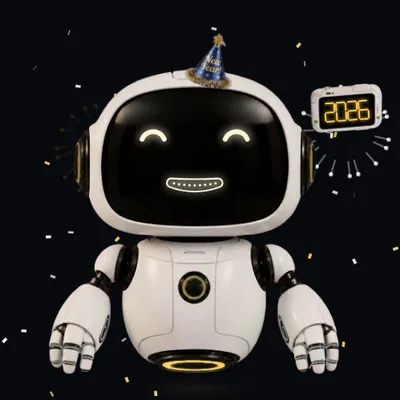

# Hovi

A voice skin for [Kiosk Satellite](https://github.com/jxlarrea/kiosk-satellite). While it is picked, your assistant is Hovi, a little hovering robot, instead of the usual overlay.

Hovi's face is drawn live on its screen, like lit glass: lens eyes with glints that blink and glance around, and a mouth that opens into a little screen of level bars as it talks. Its light strips (ear rings, chest ring, hover ring, forearms and fingers) move with the conversation.

- **Resting:** it bobs gently, blinks and looks around.
- **Listening:** a sweep of light runs up its body and keeps flashing down its arms, its ear rings pulse, and it leans in with wide eyes.
- **Thinking:** it looks up and aside while light chases round its eyes and its chest ring spins.
- **Answering:** its mouth, chest light and hover ring move with the answer.
- **Muted:** with the wake word muted, its ear rings glow red, its eyes half close and it looks down.

## Appearance

**Robot** (the default) or **Robot Cat**, the same robot with cat ears, a floating tail and a cat's face: lidded eyes with slit pupils, a cat's mouth and fibre-optic whiskers.

## Holidays

The **Holiday** setting dresses Hovi up with outfits, props and light colours: New Year's, Valentine's, St Patrick's, Easter, Canada Day, Independence Day, Thanksgiving, Halloween, Remembrance, Christmas, Birthday. Some bring extras, such as fireworks, snow, confetti or falling leaves, and Halloween and Valentine's change its eyes.

Pick one by hand, or choose **Follow Home Assistant** and set **Holiday entity** to any entity whose state names a holiday, such as an `input_select` you change yourself or a template sensor that follows the calendar. A state that isn't one of those holidays shows the everyday robot. "Independence Day", "4th of July" and "July 4th" all work, and so do the other holidays' common spellings.

## Settings

| Setting | What it does |
| --- | --- |
| Holiday | Follow Home Assistant, None, or a holiday. |
| Holiday entity | The entity Follow Home Assistant reads. |
| Frame rate | **Auto** (the default) starts at full speed and drops to 30, then 20 fps on a device that can't keep up. Each kiosk decides for itself, so it suits a fleet. **Full**, **30 fps** and **20 fps** fix the rate. |
| Darkness | 0 to 100%: how dark the white shell is. |
| Appearance | Robot or Robot Cat. |

Hovi also follows **Voice Satellite > Appearance**: Background sets how much of the dashboard shows through, Text size scales the conversation, and with Reactive activity bar off nothing moves with the voice.

## Requirements

- Kiosk Satellite 2026.10.30 or later
- The native Voice Satellite runtime turned on

## Installation

### Community Plugins (Recommended)

Hovi is listed in [Community Plugins](https://kiosksatellite.com/plugins/). Use the button below to open it in your Kiosk Satellite and install it.

Or search for `Hovi` in **Settings > Plugin Manager > Browse plugins** in Kiosk Satellite.

### Manual

1. Open **Settings > Plugin Manager** in Kiosk Satellite and turn on **Enable Plugins**.
2. Choose **Add plugin**, paste `https://github.com/dlarkinsPonderosa/hovi-voice-skin` and choose **Preview**.
3. Review the plugin and choose **Trust and install**.

## License

The code is [Apache-2.0](LICENSE). The robot artwork is not: see [ART-LICENSE.md](ART-LICENSE.md).

The SDK under `sdk/` and the build tools under `tools/` come from [kiosk-satellite-plugins](https://github.com/jxlarrea/kiosk-satellite-plugins) (Apache-2.0).
